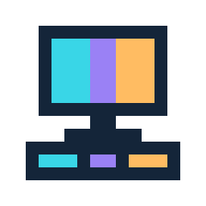

# Keyloom



Spatial screen lighting for the **Ant Esports Apex100**. Your screen is divided into 68 regions that follow the keyboard's physical layout. Each key fades toward the average color of its own region: top-left stays top-left, bottom-right stays bottom-right.

White regions light up white. Black regions turn their keys off. Every key transitions independently instead of swapping colors instantly.

**Experimental Windows utility.** Tested with one wired Apex100 using the 68-key GZS68 layout. Other keyboards, wireless modes, and firmware revisions are not guaranteed to work. This is an independent project, not affiliated with Ant Esports.

## Download and run

Download [Keyloom for Windows x64](https://github.com/Gitar101/keyloom/releases/latest/download/Keyloom-windows-x64.exe) from [Releases](https://github.com/Gitar101/keyloom/releases). Python is not needed for the packaged app. Release assets include a SHA-256 checksum file.

1. Connect your Apex100 using its **USB cable**.
2. Exit the original Apex100 application from its **system-tray menu**. Closing its window may leave it running.
3. Open `Keyloom-windows-x64.exe` and press **Start sync**.
4. Minimize Keyloom so its preview does not contribute to the captured screen.

No installer, administrator access, account, or autostart is required. The executable is unsigned; Windows may show its standard warning for an unsigned app. Do not disable antivirus or system security to run it.

## Controls

| Control | Behavior |
| --- | --- |
| Brightness | Overall output level, 0–100%. |
| Transition time | Independent per-key fade, 100–2000 ms; default 400 ms. A fixed target is approximately 99% reached in that time. |
| Black cutoff | Regions whose red, green, and blue averages are all at or below this value fade fully off. Default **16/255**, adjustable 0–64. Raise it if dark areas still glow; 0 preserves every nonzero color. |
| Preview only | Animate the screen grid and keyboard preview without opening the keyboard or sending HID reports. Stop first to switch modes. |
| Stop | Stop streaming and close the device handle. Firmware may resume its onboard lighting. |

Screen regions follow staggered rows and key widths, including Space. The full primary screen is stretched to the keyboard geometry. Colors are averaged **per region**, never across the whole screen. There is no dominant-color selection or saturation boost.

## Compatibility and safety

- Windows x64; wired USB `28E9:31A3`, interface 1, vendor usage `FF87:0020`, 64-byte reports.
- The actual primary monitor is used, even if Windows enumerates another monitor first.
- Up to 20 frames/s; capture size, CPU load, and USB latency affect the actual rate.
- The factory matrix is read on connection. All 68 visible keys must map uniquely before RGB is sent; raw USB slot order is not assumed to match visual order.
- Complete frames are streamed continuously, including static pictures, so unchanged colors do not create one-second delivery gaps.
- Only basic-info reads, factory-matrix reads, and streamed RGB are implemented. There are **no key-mapping, macro, reset, profile, function-settings, firmware, or bootloader writes**.
- Keyloom refuses to start while `Apex100.exe` runs, and shares a single-instance lock with the earlier Screen Sync prototype. Close other RGB applications too; no application can guarantee universal exclusivity against third-party software.
- HDR, protected video, secure desktops, remote sessions, and exclusive-fullscreen games may capture inaccurately. Test ordinary desktop content first.
- Successful USB acknowledgements do not prove visual output on every firmware. If you see flicker, incorrect alignment, or an unsupported-layout error, stop syncing and report the model/firmware details. Do not send guessed device commands.

## Privacy

Normal operation processes captures in memory. It does not save or upload screenshots, record keystrokes, enumerate browser content, or use a network service. Settings are session-only. Local error logs rotate under `%LOCALAPPDATA%/Keyloom/`.

The optional diagnostic tools are separate: `verify_ui.py` explicitly saves the app window, and the smoke/live tools write local color/timing JSON. These outputs are ignored by Git and are not included in releases. Review diagnostics yourself before sharing them. See [privacy details](docs/privacy.md).

## Build from source

Use Python 3.12 x64 with Tk support. From the repository directory:

```powershell
uv venv --python 3.12 .venv
uv pip install --python .venv/Scripts/python.exe -r requirements-dev.txt
.venv/Scripts/python.exe -m pytest -q
.venv/Scripts/python.exe screen_sync.py
./build.ps1
```

The build regenerates the pixel icons, runs tests, collects dependency license notices, and produces `dist/Keyloom.exe` using PyInstaller. The executable and native windows use the same icon. You can use `python -m venv .venv` and `python -m pip` instead of uv if preferred.

The test suite uses fake transports and sends no hardware reports. [Testing instructions](docs/testing.md) describe preview-only and explicit live checks. [Protocol notes](docs/protocol.md) document the limited supported commands.

## Build story and artwork

Read [how Keyloom was built](docs/blog/keyloom.md), or use the [X launch draft](docs/launch/x-post.md). The [edited blog cover](docs/assets/keyloom-cover.png) combines a supplied product photo with the actual UI; it is not proof of live keyboard output. See [artwork credits](docs/assets/README.md).

The original pixel mark is available as [SVG](assets/keyloom.svg), [Windows icon](assets/keyloom.ico), [favicon](assets/favicon.ico), and PNGs in `assets/`. Regenerate them with `python tools/build_branding.py`; all sizes come from one 16-pixel drawing and retain sharp edges.

## License

Original Keyloom code and the pixel icon are [MIT licensed](LICENSE). Dependencies and the supplied product photograph retain their respective licenses and rights; see [third-party notices](THIRD_PARTY_NOTICES.md) and [artwork credits](docs/assets/README.md). No vendor executables, DLLs, firmware, or original application assets are distributed.
