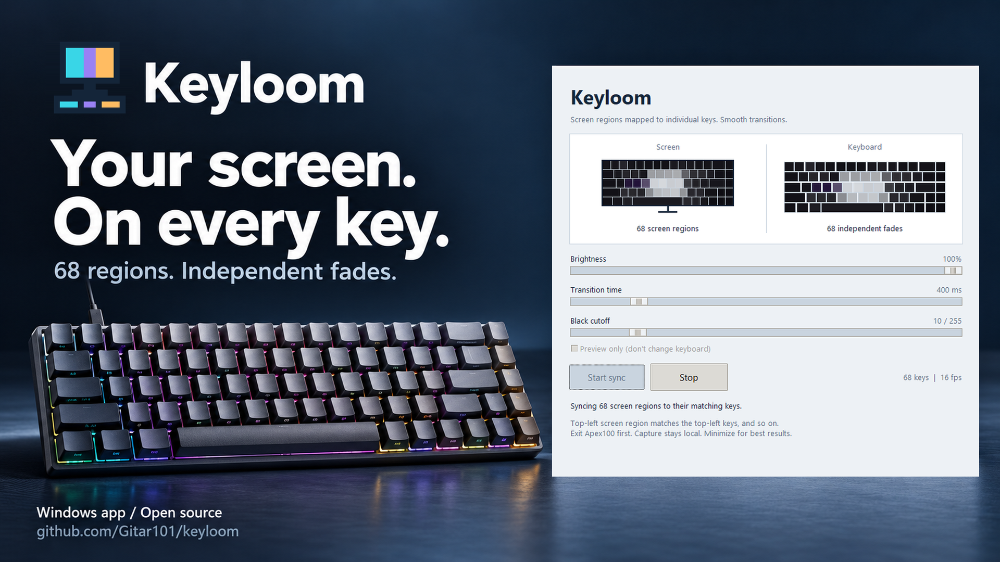

# I made my Apex100 keyboard follow my screen

My Ant Esports Apex100 already had RGB effects. What I wanted was more specific:
if the top-left of my screen turned blue, the top-left keys should turn blue.
If a region went black, those keys should fade off.

That became **Keyloom**, a small, open-source Windows app that maps screen
colors to individual keys on my wired Apex100.

[Download Keyloom](https://github.com/Gitar101/keyloom/releases/latest) or
[read the source](https://github.com/Gitar101/keyloom).

## One screen, 68 regions

Making the entire keyboard match one average screen color was the first idea.
It lost too much information. A blue sky above an orange landscape should not
become one muddy color across every key.

Keyloom divides the primary screen into 68 regions that follow the keyboard's
physical layout. Each region supplies the average RGB color for its matching
key. The mapping keeps the same orientation: top-left goes to top-left, and
bottom-right goes to bottom-right.

The regions account for staggered rows and wider keys, including Space. They
cover the whole screen, rather than sampling only its edges.

## Finding the right key was harder than finding the color

The interesting part was getting those colors to the hardware.

I traced the existing Windows software's lighting and USB HID paths to
understand its RGB packet format. That did not recover the original source
code or tell me everything about the firmware. It gave me enough evidence to
implement a deliberately small set of commands.

There was another catch: visual key order is not the same thing as USB buffer
order. On connection, Keyloom reads the keyboard's factory matrix and resolves
all 68 visible keys to their hardware positions. If those mappings are missing
or ambiguous, it refuses to stream RGB instead of guessing.

The app implements basic-info reads, factory-matrix reads, and RGB streaming.
It does not write key mappings, macros, profiles, resets, or firmware.

## Smooth changes without a color queue

Instant color changes felt harsh, so each key fades independently toward its
current target. The default transition is 400 milliseconds, adjustable from
100 to 2,000 milliseconds.

The smoothing uses elapsed time rather than assuming every frame arrives at
the same interval. A new target updates the fade immediately; old colors do
not sit in a queue waiting to play out. For a fixed target, the selected
transition time gets the output approximately 99% of the way there.

Black needed its own control. Dark screen regions can average to a small
nonzero value, which leaves keys faintly glowing. The adjustable black cutoff
turns sufficiently dark targets into true zero RGB before smoothing. Those
keys then fade fully off.

## A lesson from static images

An early optimization skipped unchanged frames for too long. That reduced USB
traffic, but it also created long gaps in RGB delivery.

Keyloom now sends complete frames continuously, even when the picture is
static. I also replaced a slow subprocess-based process check with native
Windows enumeration to reduce avoidable pauses.

The loop is capped at 20 frames per second. Tests on my setup were generally
around 16 to 18 fps; capture load and USB latency affect the actual rate. USB
acknowledgements alone are not proof of correct visual output on every firmware.

## Small app, local capture

The interface has screen and keyboard previews, brightness, transition time,
black cutoff, and Start/Stop controls. Preview-only mode lets you try the
capture and fades without opening the keyboard connection.

Normal operation processes screen captures in memory. It does not save or
upload screenshots, use a cloud service, or require an account. The packaged
Windows executable does not need a Python installation or administrator access.

## Try it, with the limits in mind

This is experimental software tested on one wired Apex100 with the 68-key
GZS68 layout. Other keyboards, wireless modes, and firmware revisions are not
guaranteed to work. HDR, protected video, and some fullscreen capture paths can
also behave differently.

Connect the keyboard by USB, exit the original Apex100 app from its tray menu,
then open Keyloom and press **Start sync**. Minimize its window so the preview
does not feed back into the screen capture. The executable is unsigned; do not
disable Windows security or antivirus to run it.

If you try it, report your model, firmware if known, and whether the spatial
alignment works. That is more useful than assuming every Apex100 is identical.

**Source:** https://github.com/Gitar101/keyloom

**Windows download:** https://github.com/Gitar101/keyloom/releases/latest

Keyloom is an independent project, not affiliated with Ant Esports. Code and
the original pixel icon are MIT licensed. The cover is edited promotional
artwork using a supplied manufacturer keyboard photo and a real Keyloom UI
screenshot; it is not a photograph proving live output. See the
[artwork credits](../assets/README.md).

**Suggested share tags:** #BuildInPublic #OpenSource #MechanicalKeyboards
